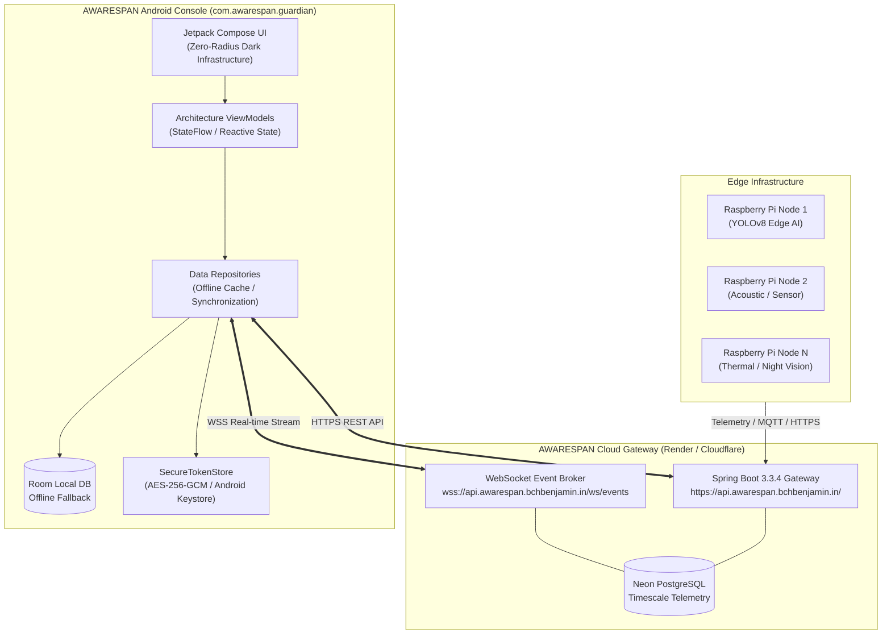

# AWARESPAN — Android Operational Console

[](https://github.com/awarespan/android-app/releases/tag/v0.4.0)
[](https://github.com/awarespan/android-app/actions)
[](https://developer.android.com)
[](https://kotlinlang.org)
[](https://developer.android.com/jetpack/compose)
[](docs/DESIGN_SYSTEM.md)

> **Awareness Without Boundaries.**  
> The official Android operational console for the **AWARESPAN** distributed edge AI safety ecosystem.

---

## 1. Application Identity

| Attribute | Value |
| :--- | :--- |
| **Brand Name** | **AWARESPAN** |
| **Brand Tagline** | *Awareness Without Boundaries.* |
| **Application Label** | `AWARESPAN` |
| **Application ID / Namespace** | `com.awarespan.guardian` |
| **Version Name** | `0.4.0` |
| **Version Code** | `5` |
| **Minimum SDK** | API 26 (Android 8.0 Oreo) |
| **Target / Compile SDK** | API 35 (Android 15) |
| **Repository** | [`awarespan/android-app`](https://github.com/awarespan/android-app) |
| **Production Gateway** | `https://api.awarespan.bchbenjamin.in/` |

---

## 2. Technical Overview

The AWARESPAN Android application provides an operational interface for security operators, field personnel, and system evaluators. It interfaces with the AWARESPAN backend to provide:

- **Real-Time Threat Telemetry**: Streaming WebSocket events delivering multi-modal AI threat detections (visual, acoustic, nocturnal) with sub-second latency.
- **Human-in-the-Loop Verification**: Workflows that separate immutable edge AI predictions from human verification outcomes (`CONFIRMED`, `FALSE_ALARM`, `UNCERTAIN`).
- **Edge Node Health Monitoring**: Fleet-wide heartbeat tracking, GPS coordinate mapping, battery levels, and sensor diagnostic states.
- **Autopilot Policy Tuning**: Configurable autonomous deterrence parameters (sound alarms, strobes, automated escalation).
- **Offline-First Resilience**: Local Room database caching ensuring field operators maintain uninterrupted visibility even during intermittent cellular connectivity.

---

## 3. System Architecture & Boundaries

The Android client connects **exclusively** to the Spring Boot API Gateway via encrypted HTTPS and WebSocket (WSS) connections.



> [!IMPORTANT]
> **Strict Architectural Boundary**: The Android application **never** connects directly to edge hardware nodes (Raspberry Pi devices), MQTT message brokers, or the Neon PostgreSQL database. All interactions are securely routed, authenticated, and audited through the Spring Boot API Gateway.

---

## 4. Design System: Zero-Radius Dark Infrastructure

The application interface implements the authoritative AWARESPAN design specification ([`docs/DESIGN.md`](docs/DESIGN.md)):

- **Void Black Canvas (`#000000`)**: Deep pure black background across all surfaces to maximize OLED battery longevity and reduce operator eye fatigue in night operations.
- **Ember Orange (`#FF4F2B`)**: Single high-visibility accent color reserved strictly for actionable triggers, active alarms, and critical interactive components.
- **Zero-Radius Architecture (`0dp`)**: Complete rejection of Material 3 rounded cards and pill buttons. All containers, buttons, badges, and text inputs adhere to sharp, architectural geometry.
- **Hairline Graphite Borders (`#3C3C3C`, 1dp)**: Structural hierarchy communicated through 1dp solid borders rather than drop shadows.
- **Monospaced Operational Readouts**: Terminal typography for hardware node identifiers, ISO-8601 timestamps, confidence metrics, and state badges.

Detailed component guidelines and Jetpack Compose token mappings are documented in [`docs/DESIGN_SYSTEM.md`](docs/DESIGN_SYSTEM.md).

---

## 5. Technology Stack

| Component / Layer | Technology | Version | Purpose |
| :--- | :--- | :--- | :--- |
| **Language** | Kotlin | `1.9.24` | Presentation layer, ViewModels, Compose UI |
| **Core Domain** | Java | `17` (Temurin) | Domain models, repository contracts, mappers |
| **UI Framework** | Jetpack Compose | BOM `2024.06.00` | Declarative UI, state-driven rendering |
| **DI Engine** | Dagger Hilt | `2.51.1` | Dependency injection across app lifecycle |
| **Local Cache** | AndroidX Room | `2.6.1` | Offline-first SQLite database and DAOs |
| **REST Networking** | Retrofit / OkHttp | `2.11.0` / `4.12.0` | API communication, interceptors, SSL pinning |
| **WebSocket** | OkHttp WebSocket | `4.12.0` | Persistent bi-directional event stream |
| **Security** | AndroidX Security | `1.1.0-alpha06` | `EncryptedSharedPreferences` with Keystore |
| **Image Loading** | Coil Compose | `2.6.0` | High-performance image loading with memory cache |
| **Video Playback** | Media3 / ExoPlayer | `1.3.1` | Incident video evidence playback |
| **Build System** | Gradle | `8.9` | Build automation, R8 shrinking, ProGuard |
| **Android Gradle** | AGP | `8.5.1` | Android compilation plugin |

---

## 6. Build & Setup Instructions

### 6.1 Prerequisites
- **JDK**: OpenJDK 17 or Eclipse Temurin 17+
- **Android SDK**: Build-Tools `35.0.0` or `34.0.0`, Platform `android-35`
- **Gradle**: Managed automatically via the included `./gradlew` wrapper

### 6.2 Running Unit Tests
Validate data mappers, WebSocket message parsers, authentication logic, and domain state machines:
```bash
cd android
./gradlew testDebugUnitTest
```

### 6.3 Building Debug APK
```bash
cd android
./gradlew assembleDebug
```
Output artifact: `android/app/build/outputs/apk/debug/app-debug.apk`

### 6.4 Building Release APK
The release build enforces full ProGuard/R8 dead-code elimination, member obfuscation, and resource shrinking:
```bash
cd android
./gradlew assembleRelease --no-daemon
```
Output artifact: `android/app/build/outputs/apk/release/app-release-unsigned.apk` (or `app-release.apk` if signing credentials are provided).

### 6.5 Signing Configuration
To generate a cryptographically signed release APK, supply the following environment variables:
```bash
export AWARESPAN_KEYSTORE_FILE="/path/to/release.jks"
export AWARESPAN_KEYSTORE_PASSWORD="your-keystore-password"
export AWARESPAN_KEY_ALIAS="your-key-alias"
export AWARESPAN_KEY_PASSWORD="your-key-password"

./gradlew assembleRelease
```

---

## 7. Security & Diagnostic Logging Architecture

### 7.1 Security & Cryptographic Safeguards
1. **Hardware-Backed Key Storage**: Master keys are generated inside the Android Keystore system (`MasterKey.KeyScheme.AES256_GCM`). Tokens are encrypted on-disk using AES-256-SIV (keys) and AES-256-GCM (values).
2. **Transparent Token Rotation**: `TokenRefreshAuthenticator` intercepts `401 Unauthorized` responses and synchronizes refresh token requests to renew expired JWT access tokens without interrupting operator workflows.
3. **Encrypted Transport Only**: `android:usesCleartextTraffic="false"` is strictly enforced in `AndroidManifest.xml`. All network communication requires TLS 1.3 / TLS 1.2 with valid CA trust anchors.
4. **ProGuard / R8 Obfuscation Defense**: Critical network DTOs and Room entities are protected via keep rules in [`proguard-rules.pro`](android/app/proguard-rules.pro), eliminating `ClassCastException` and deserialization failures under aggressive release optimization.

### 7.2 Diagnostic Logging & Privacy Protection
The application maintains a bounded, app-private diagnostic log store for operational support and troubleshooting without exposing sensitive data:
- **Bounded Storage (< 512 KB)**: Managed by `DiagnosticLogger`, using a rolling log buffer (up to 4 rotated log files, 128 KB each) stored in `context.filesDir/diagnostics/`. Prevents disk bloat on low-storage devices.
- **Automatic Secret Redaction**: All operational logs pass through regex filters that redact JWT tokens (`Bearer ey...`), client secrets, passwords, and private API keys before writing to disk.
- **Categorized Operational Subsystems**:
  - `Awarespan.Auth`: Session authentication, token refresh lifecycle.
  - `Awarespan.Network`: REST API telemetry, HTTP statuses, round-trip durations (no payload body leaks).
  - `Awarespan.Sync`: WorkManager background synchronization tasks.
  - `Awarespan.Realtime`: WebSocket connection state, heartbeat frames, topic subscriptions.
  - `Awarespan.Node`: Node health, telemetry parsing, and status transitions.

### 7.3 Operator Diagnostic Export Workflow
Operators can generate an encrypted/sanitized diagnostic archive directly from the UI:
1. Navigate to the **Settings** screen (bottom navigation bar).
2. Under **Diagnostics & Support**, tap **Export Diagnostics**.
3. The application bundles `system_info.json`, `operational_events.log`, and `README.txt` into a timestamped `.zip` archive inside cache storage.
4. The native **Android Sharesheet** opens securely via `androidx.core.content.FileProvider`, allowing the operator to send the report via email, cloud drive, or messaging to support teams.

### 7.4 Developer / Field Engineer Logcat Access
For live troubleshooting in lab or field environments, stream filtered subsystem logs via ADB:
```bash
adb logcat -s Awarespan.Auth Awarespan.Network Awarespan.Sync Awarespan.Realtime Awarespan.Node
```

---

## 8. Release Artifacts & Verification

### v0.4.0 Release Artifacts

| Binary | Path | Size | SHA-256 Hash |
| :--- | :--- | :--- | :--- |
| **Release APK (Signed)** | `release-v0.4.0/app-release.apk` | 1.64 MB | `0d627103df4a4e698a27b47caf5f774bf6f420f1f48335a0fa3879ec3b39f3af` |

### Package Verification (`aapt dump badging`)
```text
package: name='com.awarespan.guardian' versionCode='5' versionName='0.4.0'
sdkVersion:'26' targetSdkVersion:'35'
application-label:'AWARESPAN'
application-icon-160:'res/drawable/ic_awarespan_logo.xml'
```

---

## 9. Comprehensive Documentation Index

All in-depth engineering documentation is maintained under [`docs/`](docs/):

- [`docs/ARCHITECTURE.md`](docs/ARCHITECTURE.md) — Clean architecture layers, reactive StateFlow patterns, and offline-first Room cache.
- [`docs/DESIGN_SYSTEM.md`](docs/DESIGN_SYSTEM.md) — Authoritative color tokens, zero-radius geometry, and custom Compose components.
- [`docs/API_INTEGRATION.md`](docs/API_INTEGRATION.md) — Live REST endpoints, WebSocket event contracts, and payload schemas.
- [`docs/AUTHENTICATION.md`](docs/AUTHENTICATION.md) — Android Keystore, EncryptedSharedPreferences, and token rotation lifecycle.
- [`docs/BUILD_AND_RELEASE.md`](docs/BUILD_AND_RELEASE.md) — Build variants, signing configurations, R8 rules, and release checklists.
- [`docs/TESTING.md`](docs/TESTING.md) — Unit test suite breakdown, MockWebServer integration, and UI verification matrix.
- [`docs/RELEASE_NOTES_v0.4.0.md`](docs/RELEASE_NOTES_v0.4.0.md) — Full changelog and verification audit for version 0.4.0.

---

## 10. License & Attribution

Copyright © 2026 AWARESPAN Team. All rights reserved.  
Official Contact: [awarespan@bchbenjamin.in](mailto:awarespan@bchbenjamin.in)
